# Using agent skills

## Overview

This repository (`Bert0ns/agent-skills`) contains engineering skills for coding agents, indexed on [skills.sh](https://skills.sh/). Compatible agents include Antigravity, Claude Code, Cursor, Codex, Windsurf, and Gemini CLI.

This skill routes incoming tasks to the matching skill for each stage of development.

---

## Skill discovery and routing

When a task arrives, identify the primary goal and invoke the matching skill:

```mermaid
flowchart TD
    Task([Task arrives]) --> Intent{Primary goal?}

    %% Ideation and scoping
    Intent -->|Clarify vague idea| Idea[idea-refine]
    Intent -->|Test assumptions| Grill[grill-me / grilling]
    Intent -->|Manage context limits| Context[context-engineering]
    Intent -->|Cut conversation tokens| Cave[caveman]

    %% Architecture and design
    Intent -->|Generate C4 architecture docs| SysDocs[system-design-docs]
    Intent -->|Find shallow modules| ArchSmells[improve-codebase-architecture]
    Intent -->|Smallest change / YAGNI| Pony[ponytail]
    Intent -->|Strict TypeScript types| TS[typescript-best-practices]

    %% Code quality and review
    Intent -->|Multi-agent codebase audit| DistAudit[distributed-code-audit]
    Intent -->|Review standards and specs| Review[code-review]
    Intent -->|Audit bloat and conditionals| Thermo[thermo-nuclear-code-quality-review]
    Intent -->|Simplify logic| Simplify[code-simplification]
    Intent -->|Security and OWASP audit| Sec[security-and-hardening]
    Intent -->|Remove AI boilerplate| Deslop[deslop]
    Intent -->|Cut AI tells from writing| Unslop[unslop]

    %% Implementation and testing
    Intent -->|Red-green-refactor loop| TDD[tdd]

    %% Frontend and mobile
    Intent -->|Distinctive UI styling| FrontDesign[frontend-design]
    Intent -->|Accessibility and UI audit| WebGuide[web-design-guidelines]
    Intent -->|React and Next.js performance| ReactRules[vercel-react-best-practices]
    Intent -->|React Native and Expo patterns| NativeRules[vercel-react-native-skills]
```

---

## Available skills by category

### 1. Ideation, scoping, and context

- `idea-refine`. Clarify ideas with structured divergent and convergent thinking.
- `grill-me`. Interview user to test assumptions before building.
- `grilling`. Question engine backing `grill-me`.
- `context-engineering`. Curate active files, rules, and token budgets to keep context within limits.
- `caveman`. Terse communication voice that cuts fluff and saves tokens while keeping technical facts.

### 2. Architecture and engineering practices

- `system-design-docs`. Generate C4 diagrams and docs under `docs/architecture/` with subagents.
- `improve-codebase-architecture`. Scan shallow modules and generate an interactive HTML report.
- `ponytail`. Smallest working change, minimal diffs, standard libraries, and no bloat.
- `typescript-best-practices`. Enforce typed boundaries, runtime validation, and domain modeling.
- `tdd`. Test-driven development with red-green-refactor loops.

### 3. Code quality, review, and anti-slop

- `distributed-code-audit`. Partition codebase across parallel review agents and generate an HTML scorecard.
- `code-review`. Run two review passes for repository standards and task specs.
- `code-simplification`. Simplify logic and cut unnecessary abstractions without breaking behavior.
- `security-and-hardening`. Audit code against OWASP Top 10, auth flaws, and dependency risks.
- `thermo-nuclear-code-quality-review`. Strict audit for bloated files, tangled logic, and leaky abstractions.
- `deslop`. Remove AI boilerplate, duplicate comments, and defensive clutter from code.
- `unslop`. Cut AI writing tells, filler phrases, and sycophantic phrasing from prose.

### 4. Frontend, design systems, and mobile

- `frontend-design`. Guide visual hierarchy, typography, and color to avoid generic default styling.
- `web-design-guidelines`. Audit interfaces for accessibility, keyboard navigation, and layout consistency.
- `vercel-react-best-practices`. Apply performance and composition rules for React and Next.js applications.
- `vercel-react-native-skills`. Apply performance patterns for React Native and Expo lists and animations.

---

## Core operating behaviors

These rules govern agent execution across all skills:

1. **Surface assumptions early.** State non-obvious assumptions before making multi-file changes.
2. **Clarify confusion.** When requirements or code are unclear, stop and ask. Never guess.
3. **Push back with tradeoffs.** If a request adds security flaws, regressions, or bloat, state the tradeoff and propose an alternative.
4. **Build the minimum.** Solve the core need with the least code. Add no speculative abstractions, options, or wrappers.
5. **Keep scope tight.** Touch only files needed for the task. Do not refactor adjacent code or delete unread comments.
6. **Verify with evidence.** Prove changes work: run tests, type checks, builds, or runtime validation. Never claim done on assumption.

---

## Common workflows

Skills can be combined for specific workflows:

- **New feature.** `idea-refine` to scope, `grill-me` to test assumptions, `ponytail` or `tdd` to build minimum code, `code-simplification` to clean logic, and `deslop` to remove AI clutter.
- **Codebase health check.** `distributed-code-audit` for parallel review, `improve-codebase-architecture` for module depth, and `security-and-hardening` for vulnerability audit.
- **Architecture documentation.** `system-design-docs` to extract C4 blueprints and markdown docs.
- **Frontend overhaul.** `frontend-design` for visual guidelines, `web-design-guidelines` for accessibility, and `vercel-react-best-practices` for runtime speed.
- **Low-token terminal work.** `caveman` to keep agent output terse during long debug sessions.
